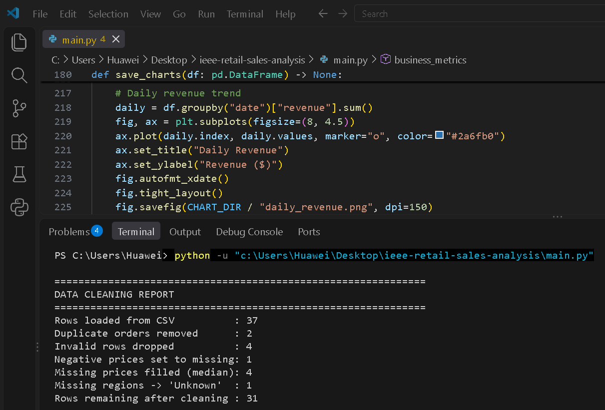
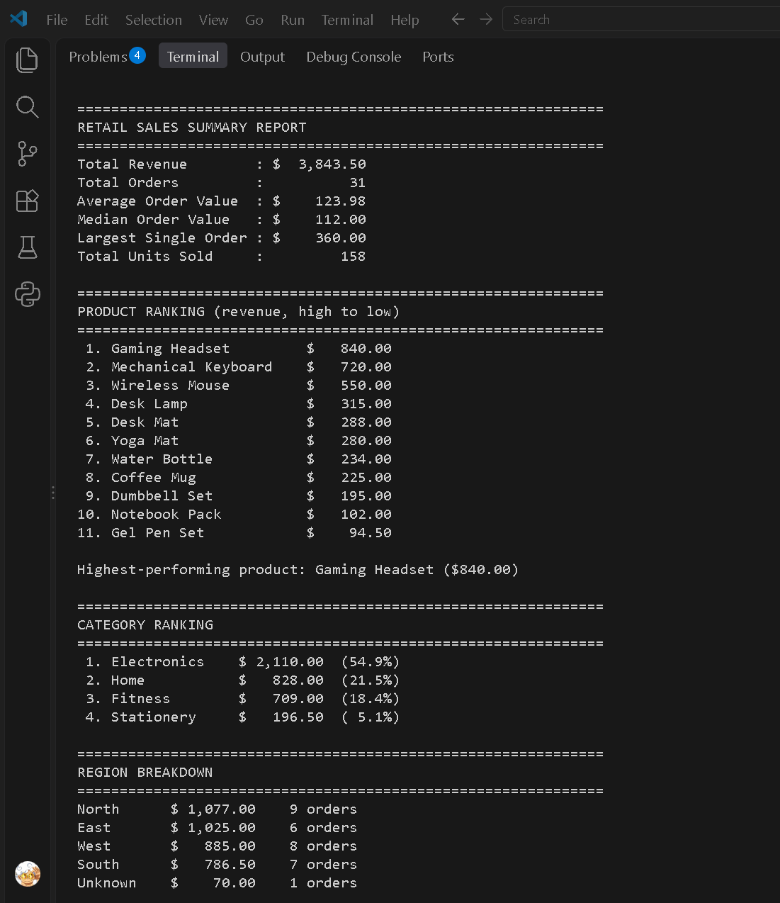
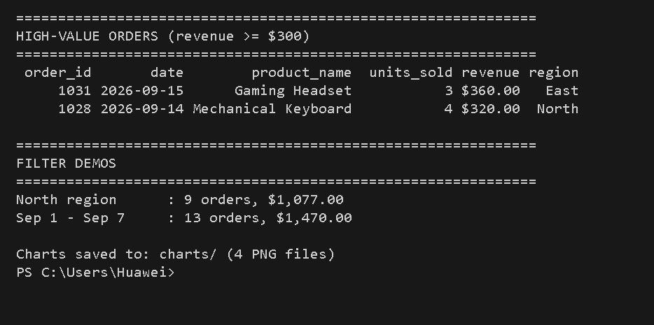
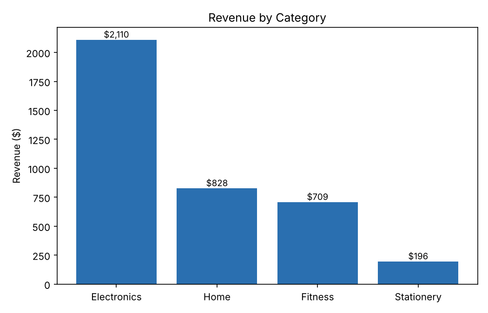
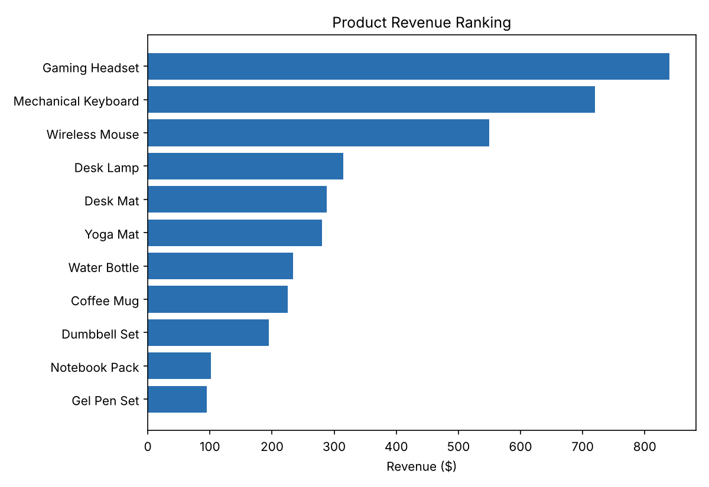
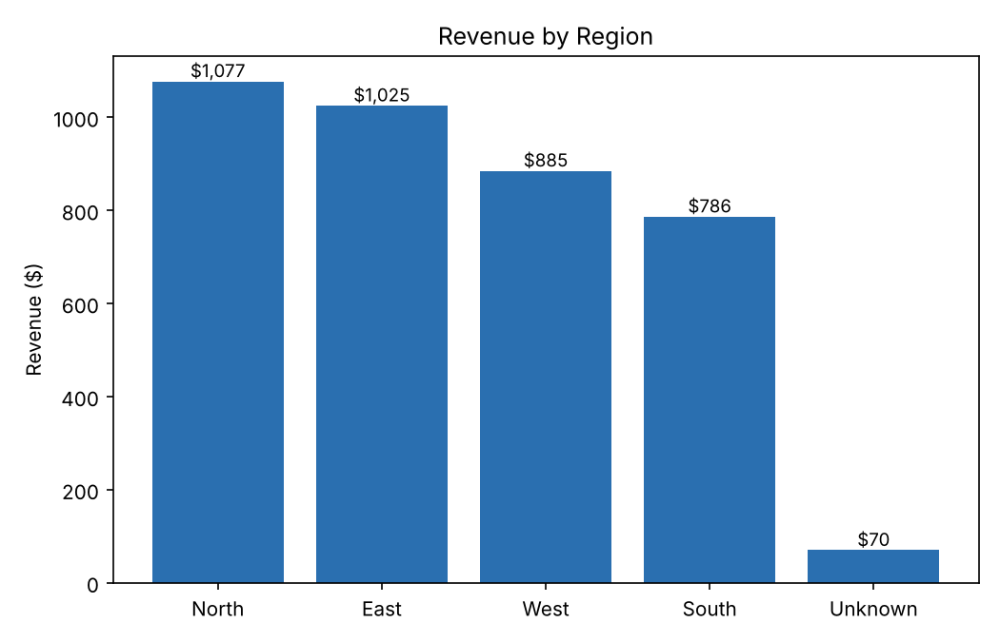
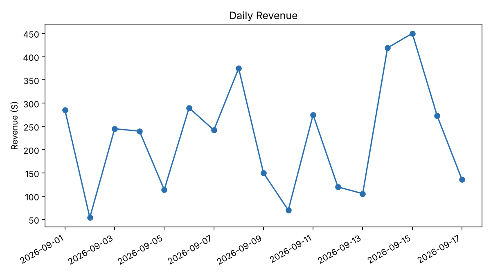

# Retail Sales Intelligence
### IEEE LGU AI/ML Cohort One — Fall 2026
**Week 3 Assignment:** Data Analysis with NumPy & Pandas
**AI/ML Leads:** Abdullah Faisal & Alina Irshad

---

## 1. Project Overview
A small retailer exported its September 2026 sales records into a raw CSV that contains duplicated orders, invalid quantities, missing and negative prices, and a missing region. This program cleans the data with Pandas, calculates revenue metrics with NumPy, and ranks products, categories and regions with `groupby`. The report shows total revenue, average order value, the best-selling product, the region breakdown and high-value orders.

## 2. Key Concepts Implemented
- [x] Pandas DataFrame Loading & Cleaning (`read_csv`, `fillna`, `dropna`, `drop_duplicates`)
- [x] NumPy Statistical Calculations (Mean, Median, Standard Deviation, Sums)
- [x] Data Grouping & Aggregation (`groupby`)
- [x] Conditional Filtering & Indexing
- [ ] Dataset Merging / Time-Series Resampling (not needed for this project)

## 3. How to Run the Program

```shell
pip install -r requirements.txt
python main.py
```

The script prints the cleaning report and the business summary to the terminal, and saves four PNG charts into the `charts/` folder.

## 4. Dataset Information & Cleaning Decisions
* **Data Source:** `data/sales.csv` is a realistic dataset I constructed for this assignment (37 raw rows, built from the example rows in the assignment brief). It is not real company data. Bad entries were added on purpose so the cleaning steps have something to fix.
* **All data is read from the CSV** with `pandas.read_csv()`. No records are hardcoded in `main.py`.

**Cleaning decisions:**

| Problem | Rows | Decision | Why |
|---|---|---|---|
| Duplicate `order_id` (1006, 1010 appear twice) | 2 | Dropped, first copy kept | The same order must not be counted twice in revenue |
| Non-numeric units (`abc`), negative units (`-3`) | 2 | Dropped | A quantity cannot be guessed, and negative units are not a valid sale |
| Missing product name | 1 | Dropped | Revenue cannot be assigned to a product |
| Invalid date (`not-a-date`) | 1 | Dropped | The order cannot be placed in time, so date filters would be wrong |
| Missing unit price | 3 | Filled with the median price of the same product | A product's price is nearly constant, so its own median is a safe estimate |
| Negative unit price (`-120.0`) | 1 | Set to missing, then filled the same way | A negative price is a data-entry error |
| Missing region | 1 | Filled with `Unknown` | The sale is real, so the revenue is kept and shown as its own group |

Result: 37 rows loaded → 31 clean rows.

## 5. Console Output Screenshots
Cleaning report:



Summary report (part 1: totals, product, category and region rankings):



Summary report (part 2: high-value orders and filter demos):



## 6. Charts (optional)
| | |
|---|---|
|  |  |
|  |  |

## 7. Project Structure
```
ieee-retail-sales-analysis/
├── README.md
├── main.py
├── requirements.txt
├── data/
│   └── sales.csv
├── charts/
└── screenshots/        (cleaning_output.png, summary_report.png, summary_report_2.png)
```
